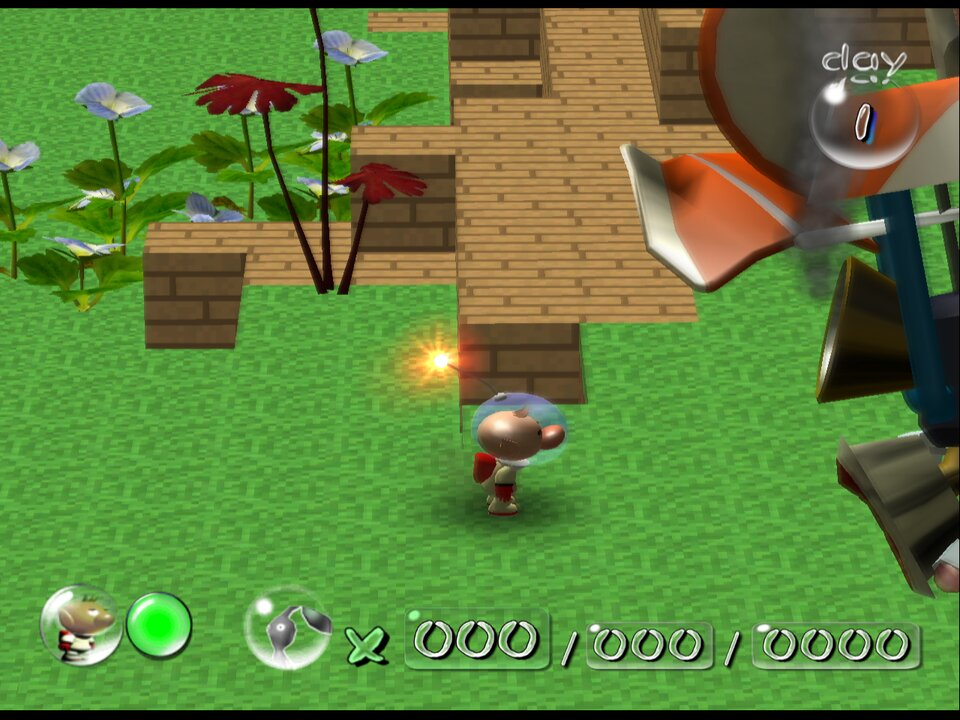
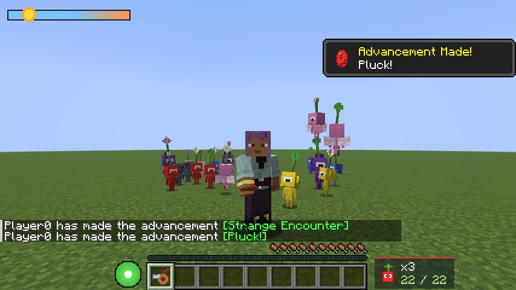
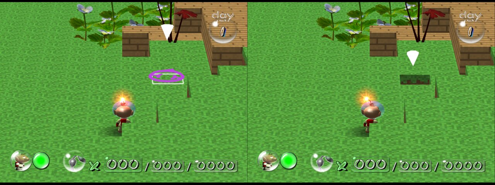
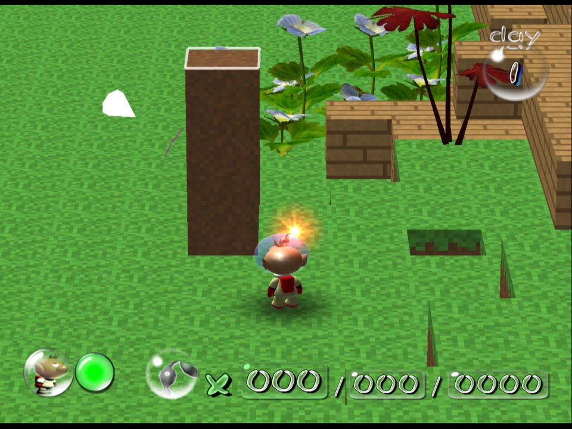
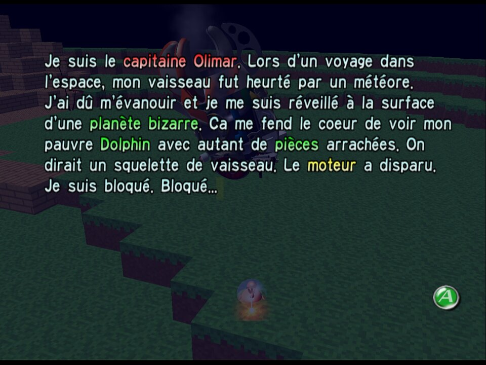

# PikCraft

[English](README.md) | **Français**

## Utilisation de l'IA : Ce jeu a été entièrement codé par Claude Code Opus 5.5.

**Minecraft dans le vrai Pikmin 1 de Nintendo.** PikCraft modifie votre propre disque de Pikmin
(GameCube) : chaque zone est reconstruite en blocs d'herbe, de terre, de pierre, de sable, de
planches, de boue et d'eau, et vous pouvez casser et poser des blocs pendant qu'Olimar et les
Pikmin descendent dans les trous que vous creusez. On y joue dans
[Dolphin](https://fr.dolphin-emu.org).



## Nouveau : PikCraft pour Minecraft (mod Fabric)

Des Pikmin dans Minecraft Java Edition 26.3 : sept types de Pikmin, des Oignons, un sifflet, des
fleurs à pastille, du nectar et des ennemis rapportés. Voir [`fabric/README.fr.md`](fabric/README.fr.md).



## Jouer

1. Téléchargez le patcher pour votre système sur la
   [page des releases](https://github.com/malik05051/pikcraft/releases) :
   `pikcraft-patcher-windows-x86_64.exe` ou `pikcraft-patcher-linux-x86_64`.
2. Lancez-le avec votre image disque de Pikmin et le nom de la nouvelle image :

   ```
   pikcraft-patcher "Pikmin.iso" "PikCraft.iso"
   ```

   Sans arguments, il vous demande les deux. Votre image d'origine n'est jamais modifiée.
3. Ouvrez `PikCraft.iso` dans Dolphin.

Il vous faut votre propre copie du jeu, en simple `.iso`/`.gcm`. Si la vôtre est en `.rvz` ou
`.gcz`, faites un clic droit dessus dans Dolphin, choisissez **Convertir le fichier…** puis
**ISO**. Le cassage et la pose de blocs nécessitent le disque PAL (GPIP01) ; les disques NTSC-U
(GPIE01) et NTSC-J (GPIJ01) ont le terrain en blocs, sans cassage.

## Casser et poser des blocs

| Bouton | Action |
| --- | --- |
| Croix ◀ | Casse le bloc du dessus sous le curseur |
| Croix ▶ | Pose un bloc à cet endroit (du type du dernier bloc cassé ; de la terre au départ) |

Tout le reste se joue comme Pikmin. Un contour blanc indique le bloc visé par le curseur.



Les trous et les nouveaux blocs modifient le sol immédiatement : Olimar et les Pikmin descendent
dans les trous que vous creusez et montent sur ce que vous construisez. Une marche d'un bloc est
une pente praticable ; au-delà, c'est un mur. Le terrain revient à son état d'origine chaque jour.



## Jouer en français

- **Le jeu :** le disque PAL (GPIP01) contient le français. Le jeu utilise la langue de la
  console : dans Dolphin, allez dans **Config > GameCube > Langue du système** et choisissez
  **Français**. Si vous avez déjà une sauvegarde, changez la langue dans **Options** sur l'écran
  titre du jeu. Les disques NTSC-U et NTSC-J n'existent qu'en anglais ou en japonais.
- **Le patcher** parle français quand votre système est en français. Utilisez `--lang fr` ou
  `--lang en` pour choisir.



## Fonctionnement

Le patcher lit la surface de collision de chaque zone et la transforme en carte de hauteur de
blocs. Sur le disque PAL, il modifie aussi le code du jeu (compilé à partir de la
[décompilation projectPiki](https://github.com/projectPiki/pikmin)) : le jeu dessine lui-même les
blocs, en tire ses collisions et gère le cassage et la pose. Les ennemis, les pièces du vaisseau et
les trajets de transport ne changent pas, donc chaque zone reste faisable.

Voir [`pikmin1/README.fr.md`](pikmin1/README.fr.md) pour toutes les options et les détails.

Ce dépôt et ses releases ne contiennent aucun fichier de Nintendo ou de Mojang. Le patcher ne fait
que réécrire l'image disque que vous lui donnez, les textures des blocs sont du pixel art original,
et le patch de code ne contient que des différences avec votre propre copie du jeu. Les captures
d'écran montrent le mod en cours d'exécution dans Dolphin.
