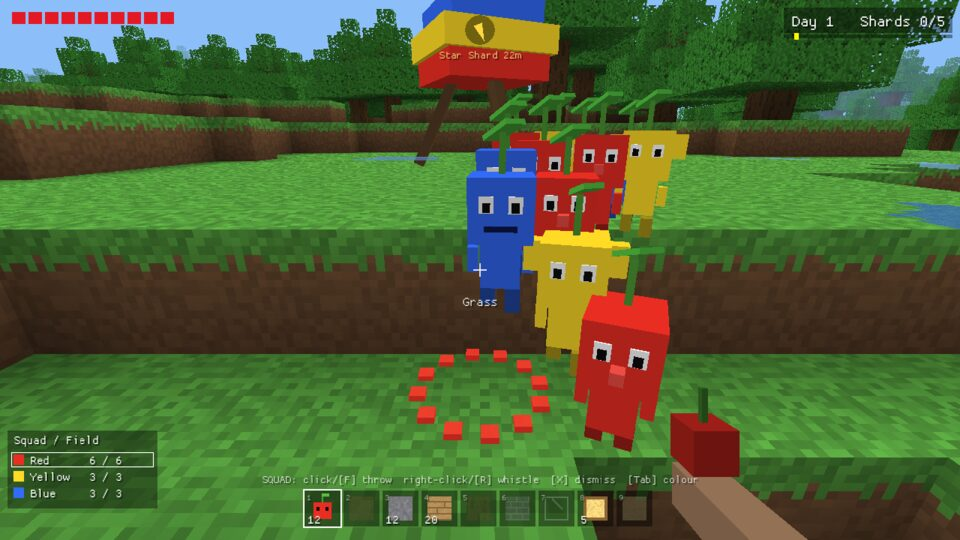
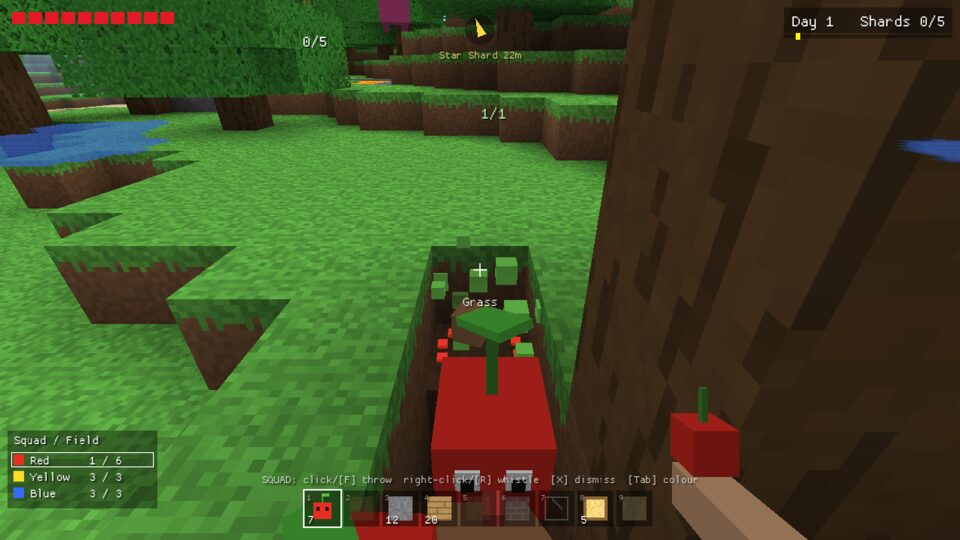
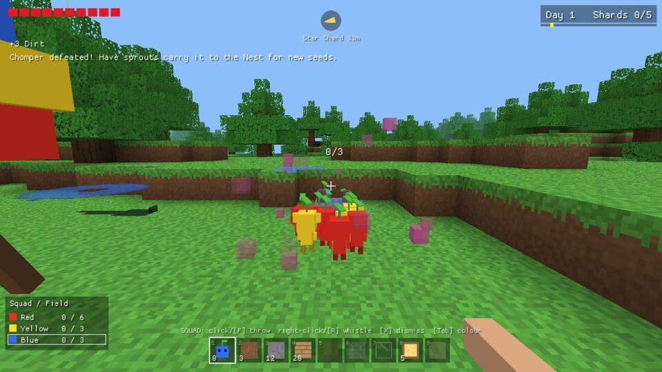
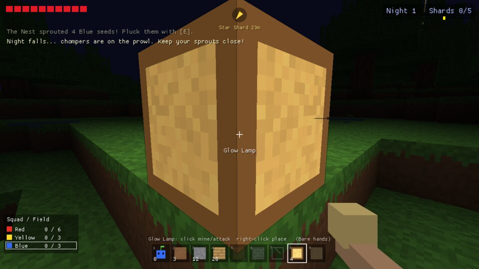

# PikCraft

A block-world sandbox crossed with squad-commanding strategy. You mine and build in a
procedurally generated voxel world, and you lead a squad of little plant creatures,
**sprouts**, who dig, fight and haul loot for you.



## Goal

Five **Star Shards** are hidden around the world. Each one is too heavy for you to carry,
so your sprouts have to haul it back to the **Nest**. Follow the compass at the top of the
screen and the golden light beams. The Nest has a green beam.

Each shard poses a different challenge:

| Shard | Challenge |
|-------|-----------|
| Meadow | A big chomper sleeps next to it |
| Hill top | High up in the mountains |
| Lava moat | Only **red** sprouts survive fire (or bridge it with blocks) |
| Lake island | Only **blue** sprouts can swim (or build a bridge) |
| Buried vault | Deep under a crystal pillar. Dig down to it |

## Sprouts

* **Red**: fire-proof, hit twice as hard.
* **Yellow**: thrown higher, dig twice as fast.
* **Blue**: can swim. Others drown in deep water.

Buried sprouts show a leaf poking out of the grass. Walk up and press **E** to pluck them.
Sprouts grow from leaf to bud to flower over time and get faster as they mature.

Throw a sprout at:

* a **block**: it digs the block out and keeps digging the same kind of block nearby.
  Other sprouts carry the drops home, and they end up in your bag.
* a **chomper**: it latches on and attacks.
* an **item**: it helps carry it. The label shows `carriers/weight`.

Carriers find their own way back to the Nest and dig a tunnel when there's no other route.



## Chompers

Chompers sleep during the day and wake when you get close. At night they all wake up and
more of them roam. Those night chompers melt at sunrise. If your sprouts carry a defeated
chomper to the Nest, it grows new sprout seeds in the colour of the sprouts that carried it.



## Controls

| Key | Action |
|-----|--------|
| WASD (QWERTY) or ZQSD (AZERTY) / Space / Shift | Move / jump & swim / sprint |
| Mouse | Look |
| 1 | Squad slot: **left-click** throws a sprout, **right-click** whistles |
| 2-9, mouse wheel | Block slots: **left-click** mines or attacks, **right-click** places |
| F | Throw a sprout (from any slot) |
| R (hold) | Whistle: recall sprouts inside the circle |
| E | Pluck a buried sprout |
| X | Dismiss the squad |
| Tab | Change which colour you throw |
| C | Crafting (planks, pickaxes, glass, bricks, glow lamps, sprout seeds) |
| F1 / F3 | Help / info overlay (position, FPS, settings) |
| L | Switch keyboard layout (QWERTY / AZERTY) |
| M / B | Music on/off / sound effects on/off |
| U | Install an available update (title screen or pause menu) |
| Esc | Pause (Q quits from the pause screen) |

### Keyboard layouts

PikCraft supports **QWERTY** and **AZERTY** keyboards. On first launch it guesses from your
system (a French or Belgian keyboard or locale selects AZERTY). The title screen shows the
current layout, and you can press **L** there or in game to switch. With AZERTY you move with
**ZQSD**, and the number row (`& é " ' ( - è _ ç`) selects hotbar slots, so you don't need Shift.

Your choices for layout, music and sounds are saved to
`%APPDATA%\PikCraft\settings.txt` (Windows) or `~/.config/PikCraft/settings.txt` (Linux).

## Sound

All sound effects and both music tracks are synthesized in code when the game starts, so
nothing is loaded from audio files. You'll hear a cheerful day tune and a slower night theme
that crossfade with the sun. Plucking, throwing, digging, the whistle, chompers, deliveries
and Star Shards each have their own sound, and sounds get quieter the further away they are.



## Updates

From v1.2.0 on, PikCraft keeps itself up to date. At startup it asks GitHub in the background
whether a newer release exists. If one does, the title screen and the pause menu show
*"Update vX.Y.Z is available - press [U]"*. Press **U** to download it, then **U** again to
restart into the new version.

* The download is checked against the SHA-256 digest that GitHub publishes for the release
  file. If it doesn't match, nothing is changed.
* The new executable replaces the old one in place (the old copy is cleaned up on the next
  start). If the game folder isn't writable, for example under `Program Files`, the game tells
  you to download the update manually.
* To turn off the check, set `updates = off` in the settings file or start the game with
  `--no-update-check`. `pikcraft --check-update` prints what the updater sees.

## Download & run

Download the latest build from the
[Releases page](https://github.com/malik05051/pikcraft/releases).

* **Windows** (10/11, x64): unzip `pikcraft-windows-x86_64.zip` and run `PikCraft.exe`.
* **Linux** (x86_64, glibc 2.34+): extract `pikcraft-linux-x86_64.tar.gz` and run `./pikcraft`.
  You need an OpenGL driver plus `libGL`, `libX11`, `libXi` and `libasound` (ALSA, which also
  covers PulseAudio and PipeWire). Desktop distros ship all of these.

Command-line options: `--seed N` plays a specific world, and `--version` prints the version.

## Building from source

Install [Rust](https://rustup.rs), then:

```sh
cargo run --release
```

On Linux, building needs the ALSA headers (`sudo apt install libasound2-dev`). X11 and OpenGL
are loaded at runtime. On Windows nothing extra is needed.

To cross-compile a Windows build from Linux:

```sh
rustup target add x86_64-pc-windows-gnu
sudo apt install gcc-mingw-w64-x86-64
cargo build --release --target x86_64-pc-windows-gnu
```

### Tests

```sh
cargo test --release                                    # world gen, lighting, path finding, sprout AI, winnability, audio, layouts
xvfb-run -a ./target/release/pikcraft --selftest out    # scripted play-through, saves screenshots to out/
./target/release/pikcraft --export-audio sounds         # writes every synthesized sound and both music loops as WAV
```

`--selftest` plucks a squad, throws it at blocks, whistles it back, fights a chomper and
checks each step, including that the matching sounds fire. It exits with a non-zero code if
something fails. CI runs it on both Linux and Windows.

## How it's made

PikCraft is written in Rust on top of [macroquad](https://macroquad.rs). Every texture,
model and the window icon is generated in code, so the game ships as one small executable
with no asset files.

* `src/world.rs`: 160×160×64 voxel world, terrain/cave/ore generation, landmark placement,
  incremental sky and block light propagation, voxel ray casts, A* path finding (with digging).
* `src/render.rs`: procedural texture atlas, chunk meshing with ambient occlusion and smooth
  lighting, and a custom GPU pipeline with fog and day/night.
* `src/game.rs`: player, sprout AI, chompers, carrying, nest, crafting, day/night cycle.
* `src/draw.rs`: creature models, effects and HUD.
* `src/audio.rs`: a small synthesizer (oscillators, envelopes, filtered noise), the sound
  effects, the procedurally composed day/night music and playback with crossfading.
* `src/controls.rs`: QWERTY/AZERTY handling and saved settings.
* `src/main.rs`: window, input, title screen, game loop and the self-test.

PikCraft is a fan-made homage to block-building sandboxes and plant-squad strategy games.
It is not affiliated with or endorsed by Mojang, Microsoft or Nintendo, and it uses no
assets from their games.
