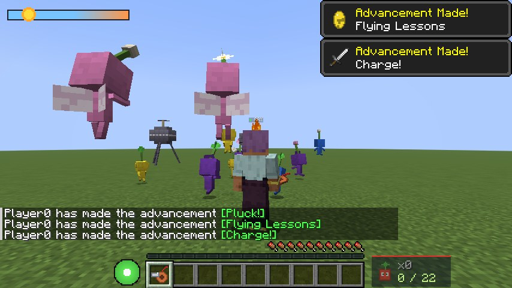
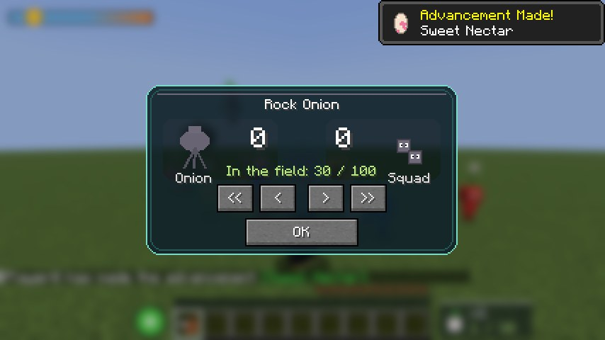
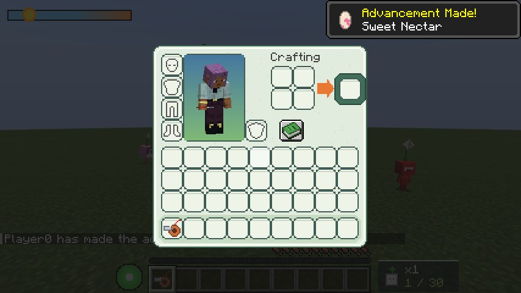

# PikCraft for Minecraft (Fabric mod)

**English** | [Français](README.fr.md)

Pikmin in Minecraft Java Edition 26.3 (Fabric). Find a sleeping Onion, pluck Pikmin, lead them with a
whistle, throw them at monsters and have them carry pellets and defeated enemies home.

## Install

1. Install [Fabric Loader](https://fabricmc.net/use/) 0.19.5 or newer for Minecraft 26.3, and
   [Fabric API](https://modrinth.com/mod/fabric-api).
2. Put `pikcraft-<version>.jar` in your `mods` folder.

Multiplayer works on a normal server: install the mod on the server and on every player's game.
It also works with [Essential](https://essential.gg)'s hosted worlds, which use the same normal
multiplayer.

## What's in it

- **Seven Pikmin types:** red (fireproof, strong), yellow (thrown higher, immune to lightning), blue
  (swims, never drowns), rock (hits hard, smashes glass and ice, can't be crushed), winged (flies),
  purple (heavy: lifts 10, stuns what it lands on) and white (fast, poisonous to whoever eats it).
  Leaf, bud and flower stages; nectar makes them bloom.
- **Your first Onion:** a sleeping Onion appears 5 to 15 blocks from you the first time you join,
  with a short camera scene. Its colour is random: red is common, yellow and blue less so, rock and
  winged rare, purple and white very rare. Touch it to wake it: it pushes you back and spits out
  your first seed. Pluck the sprout with right-click.
- **Onions:** right-click an Onion to make it follow you (outdoors only: it won't go into caves);
  right-click again to make it stay. Sneak + right-click opens the Onion menu to call Pikmin out or
  send them in (100 Pikmin in the field at most). At night Onions fly up with their Pikmin and make
  no new ones. Other Onions sleep in very large caves, and very rarely on the surface.
- **The whistle:** craft it from 3 iron ingots and 1 copper ingot (iron, copper, iron on the middle
  row, iron below the copper). Hold use to blow: the circle grows, and every Pikmin in it joins you.
- **Pellet posies:** hit the flower right in the middle to knock its pellet off (Pikmin can knock it
  off too). Pellets go to an Onion: the right colour gives more seeds.
- **Nectar eggs:** break one and the nectar stays on the ground; Pikmin drink it by themselves.
- **Carrying:** pellets and enemies are carried, never put in your inventory. Right-click one with
  an empty hand to carry it yourself.
- **Enemies:** a mob you kill drops its loot as normal. A mob killed by Pikmin falls over and its
  body is carried to an Onion for seeds. While Pikmin fight, the enemy's health shows as a
  percentage. Zombies, skeletons, spiders and creepers hunt Pikmin too.
- **Pikmin-style screens:** a health wheel instead of hearts, a squad counter and a sun meter,
  a Pikmin 3 style Onion menu and a Pikmin 4 style inventory. Advancements for waking an Onion,
  plucking, throwing, delivering and more.

## Controls

| Key | Action |
| --- | --- |
| R (or attack with the whistle in hand) | Throw the selected Pikmin where you look |
| V (hold, needs a whistle) or use the whistle | Whistle |
| C | Charge: the whole squad rushes where you look |
| X | Dismiss: the squad splits up by colour |
| G (Shift+G: back) | Select the next Pikmin type |
| Right-click a sprout | Pluck it |

Keys can be changed in **Options > Controls > Key Binds > Pikmin**.

## Build

Java 25 is needed. `./gradlew build` builds `build/libs/pikcraft-<version>.jar` and runs the
server game test. `./gradlew runClientGameTest` plays through the mod in a real client (Onion
scenes, plucking, throwing, fighting, carrying, menus, night, and a dedicated server) and saves
screenshots in `build/run/clientGameTest/screenshots`.

Textures and sounds are drawn and synthesized by `tools/make_assets.py`; language files,
advancements and the recipe come from `tools/make_data.py`. No Nintendo or Mojang assets are used.
